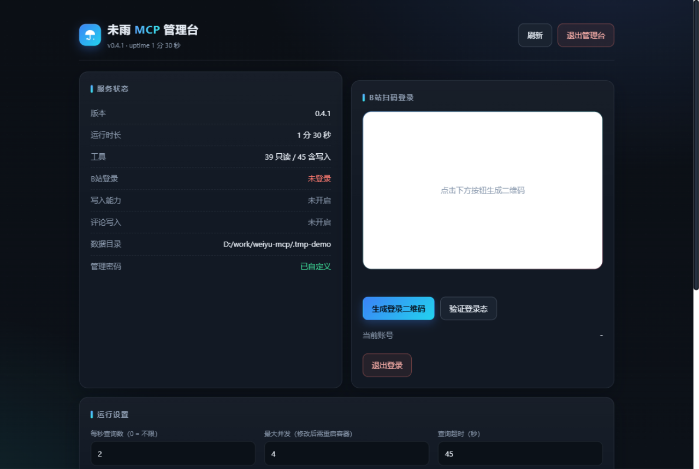
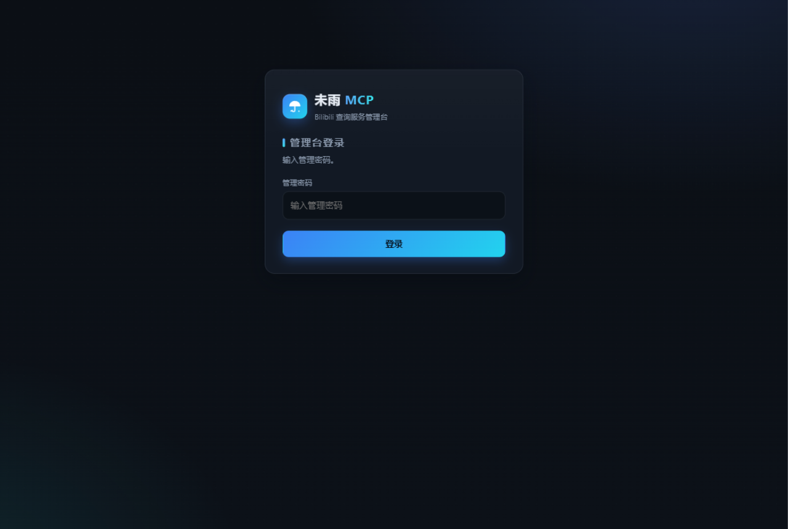

<div align="center">

# 未雨 MCP（weiyu-mcp）

**独立的 B 站查询 / 互动 MCP 服务** —— 单个静态二进制，内置 Web 管理台，面向 Linux 服务器部署，
供 Claude Desktop、ZCode、Cursor、Codex 等 AI 客户端接入。

[](https://github.com/mkktop/weiyu-mcp/actions/workflows/ci.yml)
[](https://github.com/mkktop/weiyu-mcp/releases)
[](LICENSE)
[](https://github.com/mkktop/weiyu-mcp/pkgs/container/weiyu-mcp)



*39 个只读工具 · 互动写入与评论写入独立开关 · 默认最小权限*

</div>

## 特性

| 能力 | 说明 | 默认状态 |
| --- | --- | --- |
| 39 个只读查询工具 | 搜索、解析、评论、字幕、弹幕、专栏、UP 主、榜单、个人列表、**消息通知**（@我的 / 回复我的 / 收到的赞 / 未读数） | 始终注册 |
| 互动写入（5 个工具） | 点赞、投币、收藏、稍后再看增删 | **关闭**，需显式开启 |
| 评论写入（1 个工具） | `post_comment`：发表评论、回复、@ 提及 | **关闭**，独立开关，不受互动写入影响 |
| 三种入口 | JSON CLI、stdio MCP、Streamable HTTP MCP 共用同一份工具注册表 | — |
| Web 管理台 | B 站扫码登录、开关与限速热更新、修改管理密码 | `serve` 模式内置 |
| 部署 | systemd 或 Docker（distroless、非 root、只读根文件系统），CI 产出多架构 GHCR 镜像 | — |

> **安全边界的设计**：写入类工具默认**不出现在 `tools/list` 里**。MCP 客户端会把整个工具目录交给模型，
> 从目录移除才是真正的默认关闭，"调用时才拒绝"挡不住模型去试。

## 目录

- [特性](#特性)
- [快速开始](#快速开始)
- [安全模型](#安全模型)
- [管理台](#管理台)
- [工具清单](#工具清单)
- [部署](#部署)
- [配置项](#配置项)
- [开发与测试](#开发与测试)
- [与桌面版 MCP 的区别](#与桌面版-mcp-的区别)
- [上游同步](#上游同步)
- [贡献](#贡献)
- [许可证](#许可证)

## 快速开始

```bash
cargo build --release -p weiyu-mcp
./target/release/weiyu-mcp tools          # 查看工具目录
```

Cookie：部分公开查询可匿名；搜索、字幕、AI 总结、个人列表和消息通知需要 Cookie。
在已登录 B 站的浏览器开发者工具里复制 **Cookie 请求头的值**，存成单行文件：

```bash
umask 077
printf '%s' 'SESSDATA=...; bili_jct=...; buvid3=...; DedeUserID=...; ac_time_value=...' > /etc/weiyu/bilibili.cookie
```

> Cookie 文件只在启动时读取，更新后需重启；管理台扫码登录的 Cookie 则立即热生效。空文件表示匿名运行。
> 不要使用桌面版的 Windows DPAPI `credentials.json`，它不能跨系统迁移。

stdio MCP（本地客户端直连）：

```bash
./target/release/weiyu-mcp --cookie-file /etc/weiyu/bilibili.cookie mcp
```

```json
{
  "mcpServers": {
    "weiyu": {
      "command": "/usr/local/bin/weiyu-mcp",
      "args": ["--cookie-file", "/etc/weiyu/bilibili.cookie", "mcp"]
    }
  }
}
```

远程 HTTP MCP（Bearer 令牌保护，至少 32 字符）：

```bash
openssl rand -hex 32 > mcp-token
./target/release/weiyu-mcp serve \
  --listen 127.0.0.1:8787 \
  --token-file ./mcp-token \
  --allowed-host mcp.example.com
```

```json
{
  "mcpServers": {
    "weiyu": {
      "type": "http",
      "url": "https://mcp.example.com/mcp",
      "headers": { "Authorization": "Bearer <访问令牌>" }
    }
  }
}
```

JSON CLI 也可以单独调用：

```bash
weiyu-mcp call parse_url --args '{"url":"BV17x411w7KC"}'
weiyu-mcp search 'Rust 入门' --page 1
```

- MCP 路径：`/mcp`；健康检查：`/healthz`（免令牌）。
- Host 必须通过 `--allowed-host` / `WEIYU_ALLOWED_HOSTS` 指定；带 `Origin` 的浏览器请求默认拒绝。
- 默认每秒 2 次查询、最多 4 并发、45 秒超时，可用 `WEIYU_RATE_LIMIT` / `WEIYU_MAX_CONCURRENCY` / `WEIYU_TIMEOUT_SECS` 调整。

## 安全模型

| 开关 | 解锁的工具 | 默认 | 开启方式 |
| --- | --- | --- | --- |
| （无） | 39 个只读工具，含消息通知 | ✅ | — |
| 互动写入 `allow_write` | 点赞 / 投币 / 收藏 / 稍后再看 | ❌ | 管理台勾选，或首次启动 `--allow-write` / `WEIYU_ALLOW_WRITE=true` |
| 评论写入 `allow_comment` | `post_comment`（公开发言） | ❌ | 管理台单独勾选，或 `--allow-comment` / `WEIYU_ALLOW_COMMENT=true`；**开启互动写入不会连带开启** |

Cookie 纪律：

- Cookie 只来自管理员配置的文件或管理台扫码，**永远不会**作为工具参数接收、返回给 AI 或写进日志。
- 写入与评论要求 Cookie 包含 `bili_jct`（CSRF 字段），只有 `SESSDATA` 时只读。
- 建议使用专用小号；投币等消耗性操作建议在 AI 客户端侧要求人工确认。

评论与消息通知的已知行为：

- `mentions` 必须与正文 `@昵称` 对应，B 站只有收到 `at_name_to_mid` 才会生成真实提及并通知对方；@ 自己不生成提及。
- 楼中楼回复里 @ 被回复人本人不会产生「@我的」通知：B 站每条回复只给对方发一条通知，@ 信息折叠进「回复我的」（`get_reply_feed` 条目里带 `at_details`）。想让对方在「@我的」里看到，请发一级评论 @；`get_at_feed` 的条目全部来自一级评论。
- 刚发表的一级评论可能未进入索引，立即回复会返回「没有该评论」，服务会自动等 3 秒重试一次。
- 消息通知有约 1 分钟索引延迟；`get_message_unread` 的计数不可靠（有新 @ 时也可能是 0），判断是否被 @ 请直接看 `get_at_feed`。

## 管理台

`serve` 模式在 `/admin` 提供管理台。首次访问设置管理密码（默认 `admin`），Argon2 哈希后存入
`$WEIYU_DATA_DIR/admin.json`；会话有效期 12 小时。



- 功能：B 站扫码登录（Cookie 热更新，无需重启）、验证登录态、退出登录、限速/并发/超时/写入/评论开关、修改管理密码。
- `$WEIYU_DATA_DIR/settings.json` 保存运行设置；文件存在后以文件为准，CLI/环境变量只作为首次启动的初始值。
- 忘记密码：删除 `$WEIYU_DATA_DIR/admin.json` 后重启。
- `WEIYU_ADMIN_TOKEN` / `--admin-token-file` 是**可选的**脚本用 API Bearer，管理台密码登录不依赖它。

> ⚠️ 首次设置密码之前，能访问 `/admin` 的人都可以先设置密码，部署后请立即完成首次设置。
> 默认 HTTP 直连时管理密码和令牌在局域网内明文传输：只在国内网使用，否则改回
> `WEIYU_BIND_ADDR=127.0.0.1` 走 SSH 隧道，或在前面加 Caddy/Nginx 终止 TLS（示例见 `deploy/Caddyfile.example`）。

## 工具清单

只读 39 个：

| 领域 | 工具 |
| --- | --- |
| 账号 | `get_login_status`、`get_current_user` |
| 视频 | `parse_url`、`parse_video`、`get_related_videos`、`get_ai_summary` |
| 搜索/发现 | `search_videos`、`get_hot_search`、`get_search_suggest`、`get_ranking`、`get_region_videos`、`get_pgc_rank`、`get_recommend`、`get_weekly_series`、`get_weekly_detail`、`get_precious_list` |
| 内容 | `get_video_comments`、`get_comment_replies`、`get_video_subtitles`、`get_subtitle_content`、`get_video_danmaku`、`get_article_content` |
| UP/合集 | `get_upper_info`、`get_upper_videos`、`get_upper_collections`、`get_collection_videos`、`get_followings`、`get_followers` |
| 个人列表 | `get_watch_history`、`get_favorite_folders`、`get_favorite_videos`、`get_watch_later`、`get_bangumi_follow`、`get_subscribed_collections`、`get_dynamic_feed` |
| 消息通知 | `get_at_feed`（@我的）、`get_reply_feed`（回复我的）、`get_like_feed`（收到的赞）、`get_message_unread`（未读数） |

互动写入与评论工具在对应开关开启后追加（见[安全模型](#安全模型)）。参数与 JSON Schema 以 `weiyu-mcp tools` 输出为准。

## 部署

Docker（推荐，CI 产出的多架构 GHCR 镜像）：

```bash
docker pull ghcr.io/mkktop/weiyu-mcp:latest
cd deploy && cp .env.example .env   # 配置 WEIYU_IMAGE / WEIYU_PUBLIC_HOST
docker compose up -d --no-build
```

systemd：`sudo install -m 0644 deploy/weiyu-mcp.service /etc/systemd/system/` 后启用。

📖 完整步骤、本地构建疑难排查（GCR 加速、CA 证书、iptables、buildx）、真实服务器实战记录：

- [docs/deployment.md](docs/deployment.md) — systemd / Docker 完整指南
- [docs/deployment-gm800.md](docs/deployment-gm800.md) — ARM 盒子实战与逐版本验证记录

## 配置项

| 环境变量 | 默认值 | 说明 |
| --- | --- | --- |
| `WEIYU_DATA_DIR` | 无 | 可写数据目录；存放 `settings.json`、`admin.json` 和扫码登录后的 `bilibili.cookie` |
| `WEIYU_COOKIE_FILE` | 无 | 只读 Cookie 回退文件；数据目录 Cookie 优先 |
| `WEIYU_ADMIN_TOKEN` / `WEIYU_ADMIN_TOKEN_FILE` | 无 | 可选的 admin API Bearer；管理台密码在首次访问时设置，不依赖此项 |
| `WEIYU_ALLOW_WRITE` | `false` | 首次启动的互动写入开关；`settings.json` 存在后以文件为准 |
| `WEIYU_ALLOW_COMMENT` | `false` | 首次启动的评论写入开关，独立于 `WEIYU_ALLOW_WRITE`；`settings.json` 存在后以文件为准 |
| `WEIYU_MCP_TOKEN` / `WEIYU_MCP_TOKEN_FILE` | 无 | HTTP MCP Bearer 令牌，至少 32 字符 |
| `WEIYU_LISTEN` | `127.0.0.1:8787` | HTTP 监听地址 |
| `WEIYU_ALLOWED_HOSTS` | 本机 | 逗号分隔的允许 Host |
| `WEIYU_ALLOWED_ORIGINS` | 空 | 逗号分隔的允许 Origin |
| `WEIYU_RATE_LIMIT` | `2` | 首次启动的每秒查询数，0 表示不限 |
| `WEIYU_MAX_CONCURRENCY` | `4` | 首次启动的最大并发 |
| `WEIYU_TIMEOUT_SECS` | `45` | 首次启动的单次查询超时 |

Compose 额外变量：`WEIYU_IMAGE`（镜像地址）、`WEIYU_PUBLIC_HOST`（允许的对外 Host）、`WEIYU_BIND_ADDR`（默认 `127.0.0.1`，局域网访问设 `0.0.0.0`）、`RUNTIME_IMAGE` / `CARGO_*`（构建参数）。

## 开发与测试

```bash
cargo fmt -p weiyu-mcp --check
cargo clippy -p weiyu-mcp --all-targets --no-deps -- -D warnings
cargo test --workspace --no-default-features
```

离线测试覆盖：工具目录与写入门控、参数校验、stdio/HTTP MCP 握手、Bearer 鉴权、Host/Origin、请求大小、错误码。真实账号权限、Cookie 有效性和服务器出口 IP 是否触发 B 站风控，需要在目标服务器上用实际账号验证（见 [deployment-gm800](docs/deployment-gm800.md)）。

跨架构构建：

```bash
rustup target add aarch64-unknown-linux-musl x86_64-unknown-linux-musl
pip install cargo-zigbuild==0.24.0 ziglang==0.14.1
cargo zigbuild --locked --release -p weiyu-mcp --target aarch64-unknown-linux-musl
bash scripts/package.sh aarch64-unknown-linux-musl
```

## 与桌面版 MCP 的区别

桌面版 [未雨（bilbili_copy）](https://github.com/mkktop/bilbili_copy) 内置 `Weiyu.exe --mcp` 无头模式；本服务是它的服务器版兄弟：

| 能力 | 桌面版 `Weiyu.exe --mcp` | 本服务 |
| --- | --- | --- |
| 查询 | 有 | 有（39 个只读） |
| 点赞/投币/收藏/稍后再看 | 有 | 可选（默认关闭） |
| 评论 / @ 用户 | 无 | 可选（独立开关） |
| 下载、批量下载、订阅追更 | 有 | 无 |
| 本地数据库、播放进度、设置 | 有 | 无（运行设置存 `settings.json`） |
| 登录扫码、验证码 | 有 | 管理台支持扫码登录；无验证码交互 |
| Web 管理台 | 无 | 有（`/admin`） |
| 远程 HTTP MCP | 无 | 有 |
| 部署环境 | Windows 桌面 | Linux systemd / Docker |

## 上游同步

`crates/weiyu-core` 从主仓库 [mkktop/bilbili_copy](https://github.com/mkktop/bilbili_copy) 复制而来（原因见 [UPSTREAM.md](UPSTREAM.md)）。核心改动先在上游提交，再同步过来：

```bash
scripts/sync-core.sh /path/to/bilbili_copy
git diff -- crates/weiyu-core UPSTREAM.md
cargo test --workspace --no-default-features
```

## 贡献

欢迎 Issue 和 PR：

1. `crates/weiyu-core` 的改动请先在上游仓库 bilbili_copy 提交，再走上面的同步流程。
2. 提交前确保 `cargo fmt` / `cargo clippy -D warnings` / `cargo test` 全绿。
3. 新增工具需要同步更新：工具注册表、`scripts/smoke.py` 与测试中的工具计数、README 工具清单。
4. 写入类能力保持"默认关闭、独立开关"的原则，不要让新开关被已有开关连带开启。

## 许可证

[MIT](LICENSE)
